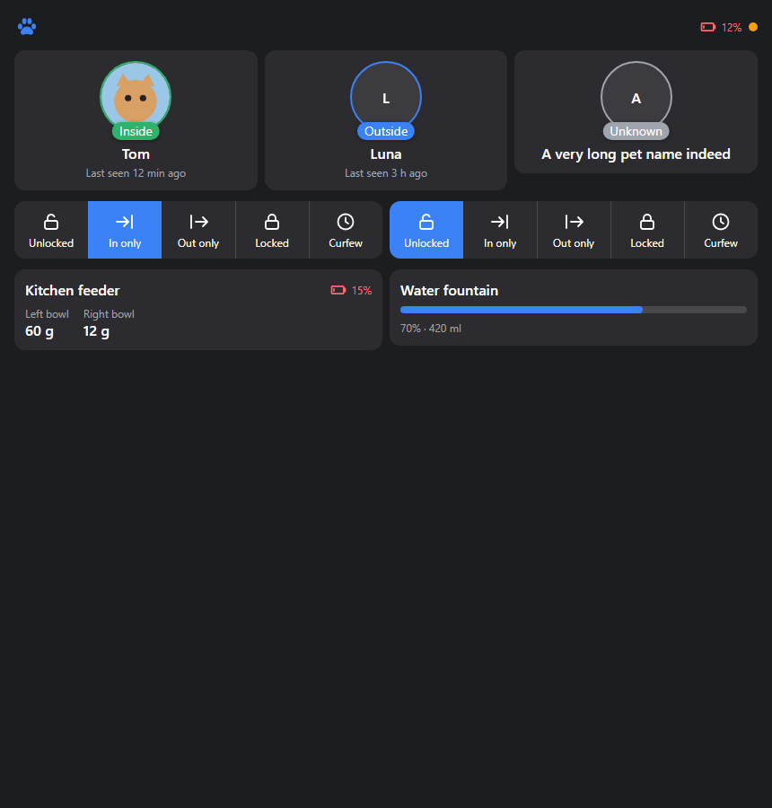
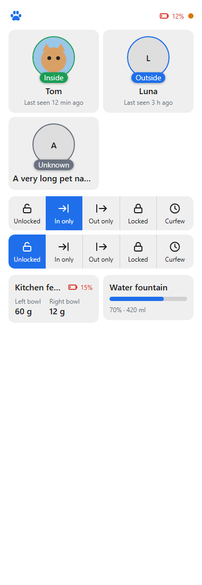

# Sure Pet Flap & Feeder for Homey

A [Homey](https://homey.app) app for **Sure Petcare** (Sure Petcare / SureFlap) devices. See where your pets are, control your pet doors, follow what your pets eat and drink, and automate it all with Flows.

> **Unofficial.** This app is not made, endorsed or supported by Sure Petcare. Sure Petcare and SureFlap are trademarks of their owners. It uses the same undocumented cloud API as the official Sure Petcare app, which can change without notice.

## Contents

- [Features](#features)
- [Requirements](#requirements)
- [How it works](#how-it-works)
- [Devices and capabilities](#devices-and-capabilities)
- [Lock modes](#lock-modes)
- [Pet settings](#pet-settings)
- [Flow cards](#flow-cards)
- [Install from source](#install-from-source)
- [Development](#development)
- [Screenshots](#screenshots)

## Features

- **Pets**: inside / outside, last seen, how much each pet ate and drank today, number of meals and drinks, trips outside, time outside, the last door used, and weight.
- **Pet doors** (Sure Petcare pet and cat flaps): set the lock mode (Normal, Keep in, Keep out, Locked, Curfew), see battery level, signal strength and online status.
- **Feeders** (SureFeed): bowl weights, last meal, battery level.
- **Water fountains** (Felaqua): water level and volume, battery level.
- **Household widget** for the Homey dashboard: pet cards with photos and status, a one-tap lock-mode bar per pet door, and feeder and fountain overview. Pets can be marked inside or outside from the widget.
- **Flows**: 20 triggers, 2 conditions and 4 actions (see [Flow cards](#flow-cards)).
- **Settings page** with the account, a pet and device overview, a force-sync button and the polling interval.
- Languages: English, Dutch, Norwegian.

## Requirements

- Homey Pro with Homey firmware **12.3.0 or later** (the dashboard widget needs it).
- A Sure Petcare account with a Sure Hub in your household.

## How it works

The Sure Petcare hub talks to Sure Petcare's cloud, and this app reads the same cloud API. Your Homey never connects to the hub directly.

- The app logs in with your Sure Petcare account and **polls** the cloud (every 60 seconds by default; you can change the interval in the app settings, from 30 seconds to 1 hour).
- A pet that walks in and out between two polls shows only its final position.
- Changes you make in Homey (lock mode, marking a pet inside or outside) are sent to the cloud and shown straight away, then confirmed by the next poll.
- Your login is stored in the Homey app settings and is only sent to Sure Petcare.
- One shared connection serves all devices, the widget and the Flows, so adding more pets or doors does not add more requests.

## Devices and capabilities

Add each device in Homey with *Add device* and choose the app. There are four device types, one for each kind of Sure Petcare product.

### Pet

One device per pet. Its values come from the hub through the cloud.

| Capability | Meaning |
| --- | --- |
| `pet_presence` | Presence: Inside, Outside or Unknown |
| `last_seen` | When Sure Petcare last saw the pet |
| `last_door` | The pet door that was used last |
| `measure_food_eaten_today` | Food eaten today (g) |
| `measure_meals_today` | Number of meals today |
| `measure_water_drunk_today` | Water drunk today (ml) |
| `measure_drinks_today` | Number of drinks today |
| `measure_trips_today` | Trips outside today |
| `measure_outside_minutes_today` | Time outside today (min) |
| `measure_weight` | Weight (kg). Only present when a weight is set in Sure Petcare |

The pet's profile (species, gender, age, microchip, weight, date of birth, food type, neutered) is shown in the device settings. See [Pet settings](#pet-settings).

### Pet door

One device per pet or cat flap.

| Capability | Meaning |
| --- | --- |
| `flap_lock_mode` | Lock mode. You can change it. See [Lock modes](#lock-modes) |
| `locked` | Simple lock switch for the standard Homey interface and voice assistants. On sets *Locked*, off sets *Normal*. It is on only in the *Locked* mode |
| `last_used_by` | Name of the pet that used the door last |
| `last_used_at` | When the door was used last |
| `measure_signal_strength` | Signal strength of the door |
| `alarm_offline` | On when the door is offline |
| `measure_battery`, `alarm_battery` | Battery level and a low battery alarm (20% or lower) |

### Feeder

One device per SureFeed feeder.

| Capability | Meaning |
| --- | --- |
| `measure_food_left`, `measure_food_right` | Weight in the left and right bowl (g) |
| `last_used_by`, `last_used_at` | The pet that ate last, and when |
| `measure_signal_strength`, `alarm_offline` | Signal strength and offline alarm |
| `measure_battery`, `alarm_battery` | Battery level and a low battery alarm (20% or lower) |

### Water fountain

One device per Felaqua fountain.

| Capability | Meaning |
| --- | --- |
| `measure_water_level` | Water level (%) |
| `measure_water_volume` | Water in the reservoir (ml) |
| `last_used_by`, `last_used_at` | The pet that drank last, and when |
| `measure_signal_strength`, `alarm_offline` | Signal strength and offline alarm |
| `measure_battery`, `alarm_battery` | Battery level and a low battery alarm (20% or lower) |

## Lock modes

| Mode | Id in Flows | What it does |
| --- | --- | --- |
| Normal | `normal` | Pets can go in and out |
| Keep in | `keep_in` | Pets can come in, but not go out |
| Keep out | `keep_out` | Pets can go out, but not come in |
| Locked | `locked` | Nobody gets through |
| Curfew | `curfew` | Follows the curfew times set in the Sure Petcare app |

Curfew times are set in the official Sure Petcare app, not in Homey.

## Pet settings

Open the pet device and its *Advanced settings*.

**Profile.** Species, gender, age and microchip are shown but cannot be changed. **Weight, date of birth, food type and neutered** can be edited, and are saved to Sure Petcare when you save the settings. A weight of 0 means no weight is set.

**Alerts and goals.** These set up three of the Flow triggers. A value of 0 turns the alert off.

| Setting | Used by |
| --- | --- |
| Maximum hours outside | *Has been outside too long* |
| Daily food goal (g) | *Reached daily food goal* |
| Daily water goal (ml) | *Reached daily water goal* |

## Flow cards

Cards that belong to one device have a device field: choose the pet, door, feeder or fountain the Flow should react to.

### Triggers

**Pet**

| Card | Fires when | Tokens |
| --- | --- | --- |
| Came inside | The pet's presence changes to Inside | `name` |
| Went outside | The pet's presence changes to Outside | `name` |
| Ate food | The pet has eaten | `name`, `amount` (g) |
| Drank water | The pet has drunk | `name`, `amount` (ml) |
| Has been outside too long | The pet has been outside longer than *Maximum hours outside*, once per stay outside | `name`, `hours` |
| Reached daily food goal | The pet's food today reaches *Daily food goal*, once a day | `name`, `amount` (g eaten today) |
| Reached daily water goal | The pet's water today reaches *Daily water goal*, once a day | `name`, `amount` (ml drunk today) |

*Came inside* and *Went outside* follow the presence you see in Homey. They fire when a pet walks through a door, when the status is changed in the Sure Petcare app, and when you mark the pet inside or outside in Homey. They do not fire for the first value after the device is added.

**Pet door**

| Card | Fires when | Tokens |
| --- | --- | --- |
| A pet used the door | The door registers a pet moving through | `name` (empty if the pet is not known), `door`, `time` |
| Lock mode changed | The lock mode changes. Choose a mode, or *Any mode* | `door`, `mode` |
| Door went offline | The door loses its connection | `door` |
| Door came back online | The door is connected again | `door` |

**Feeder**

| Card | Fires when | Tokens |
| --- | --- | --- |
| A pet ate from the feeder | A pet has eaten from the feeder | `name` (pet), `amount` (total g), `left`, `right` (g per bowl) |
| A bowl was refilled | A bowl weighs at least 10 g more than before | `name` (feeder), `bowl`, `amount` (g added) |
| A bowl drops below | A bowl passes your limit in g on its way down, once per crossing | `name` (feeder), `bowl`, `amount` (g) |

**Water fountain**

| Card | Fires when | Tokens |
| --- | --- | --- |
| A pet drank from the fountain | A pet has drunk | `name` (pet), `amount` (ml) |
| Reservoir was refilled | The water level rises by at least 10% | `name` (fountain), `level` (%) |
| Fill level drops below | The level passes your limit in % on its way down, once per crossing | `name` (fountain), `level` (%) |

**App (no device)**

| Card | Fires when | Tokens |
| --- | --- | --- |
| Battery level is low | A pet door, feeder or fountain drops to 20% or lower | `name`, `level` (%), `type` (`flap`, `feeder` or `felaqua`) |
| Intruder attempt | A microchip that is not in your household is detected at a pet door | `door`, `time` |
| Connection problem | Logging in fails or Sure Petcare cannot be reached | `reason` |

Triggers that come from feeders, fountains and doors are found by comparing two polls, so they fire up to one polling interval after the event. A restart never replays old events.

### Conditions

| Card | True when |
| --- | --- |
| Is / isn't inside | The chosen pet is inside |
| Mode is / isn't set to | The chosen pet door is in the chosen lock mode |

### Actions

| Card | What it does |
| --- | --- |
| Set lock mode | Sets the lock mode of a pet door |
| Set lock mode for a while | Sets a lock mode for 1 to 1440 minutes, then goes back to the mode the door had before. It does not go back if the mode was changed in the meantime. Pending changes survive an app restart |
| Set pet position | Tells Sure Petcare that a pet is inside or outside, for example when it came in through a door without a chip reader. *Came inside* / *Went outside* fire for this change too |
| Set pet access on a door | Lets one pet use a door freely, or makes it stay inside. Other pets are not affected. The door updates within a short time |

## Install from source

You need [Node.js](https://nodejs.org) 18 or later and the [Homey CLI](https://apps.developer.homey.app/the-basics/getting-started).

```bash
npm install
npx homey app run       # run on your Homey with live logs
npx homey app install   # install on your Homey
```

Then open the app in the Homey app settings and log in with your Sure Petcare account. Add your pets, doors, feeders and fountains as devices.

## Development

```bash
npm run build      # TypeScript
npm run lint       # ESLint
npx homey app validate --level publish
```

Project layout:

| Path | Content |
| --- | --- |
| `app.ts` | Shared API client, polling, snapshot and widget data |
| `lib/SureHubClient.ts` | Sure Petcare cloud API client |
| `lib/events.ts` | Compares two snapshots and lists what happened |
| `lib/FlowHandler.ts` | Registers flow cards and fires triggers |
| `drivers/` | `pet`, `flap`, `feeder` and `felaqua` drivers and devices |
| `widgets/household/` | Dashboard widget |
| `settings/` | App settings page |
| `.homeycompose/` | App manifest, capabilities and flow cards |

Triggers that belong to one device are device trigger cards, fired with `getDeviceTriggerCard(id).trigger(device, tokens, state)`.

## Screenshots

Widget with example data:





## Credits

Thanks to the community projects that documented the Sure Petcare API: [surepy](https://github.com/benleb/surepy), [surehub-api](https://github.com/fabieu/surehub-api) and the Home Assistant [Sure Petcare integration](https://www.home-assistant.io/integrations/surepetcare/).

## License

[MIT](LICENSE)
